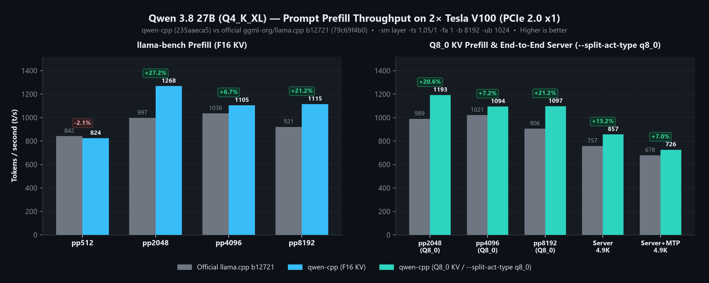
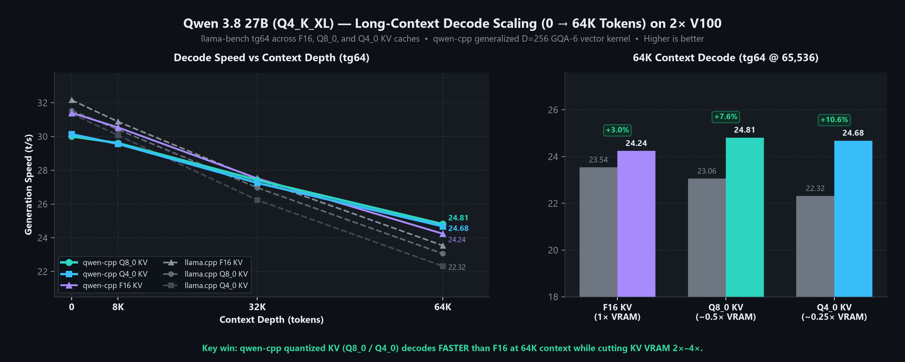

# qwen-cpp

**qwen-cpp** is an independent, performance-focused GGUF inference engine optimized for **Qwen 3.5 / 3.8** hybrid architectures (Gated Delta Net + GQA-6 Full Attention), **NVIDIA Volta (`sm_70` / Tesla V100)** multi-GPU setups over slow PCIe links, and **MTP / DFlash speculative decoding** on heterogeneous GPUs.

`qwen-cpp` is built on top of [Anbeeld's BeeLlama.cpp](https://github.com/Anbeeld/beellama.cpp) and [ggml-org's llama.cpp](https://github.com/ggml-org/llama.cpp).

[Key Additions](#key-additions-in-qwen-cpp) · [Benchmarks](#benchmarks-qwen-cpp-vs-official-ggml-orgllamacpp) · [Quick Start Guides](#quick-start--startup-guides) · [Building from Source](#building-from-source) · [Documentation](#documentation)

---

## Key Additions in qwen-cpp

- **Volta (`sm_70`) Tensor-Core Gated Delta Net (`gated-delta-net-volta`)**: Chunked WY/UT FP16 `m8n8k4` Tensor-Core prefill kernel (`S_v = 128`) plus 4-column/warp GDN decode & tail kernels (`GGML_CUDA_GDN_VOLTA_MMA`), keeping long-context Qwen 3.5/3.8 prefill fast even under rollback snapshots.
- **Volta Long-Context GQA-6 Attention & Dequantization**:
  - Generalized `D=256` GQA-6 split-K FlashAttention vector decode kernel (`flash_attn_ext_vec_gqa`) supporting **`F16`, `Q8_0`, and `Q4_0`** KV caches natively (eliminating 6× redundant KV loads on quantized KV decode), plus Volta `m8n8k4` MMA routing for small-batch verification (`Q->ne[1]` in `4..16`).
  - Fast `prmt`/`lop3` `Q4_K`/`Q3_K`/`Q2_K` → `F16` dequantization kernels for cuBLAS prefill.
  - Multi-column unpack-once `Q4_K`/`Q6_K` MMVQ (`ncols_dst = 2..4`), hoisted row-outer offsets, `cuBLAS` `src1` F16 cache (`GGML_CUDA_CUBLAS_CACHE_SRC1`), and chunked CUDA graphs (`GGML_CUDA_GRAPH_CHUNK_SIZE`).
- **PCIe-Constrained Multi-GPU Splitting**:
  - `--split-act-type`: Compresses cross-GPU residual activations (e.g. `q8_0`) between pipeline layer splits to cut transfer bottlenecks on PCIe 2.0/3.0 links.
  - Dynamic 2-copy `pipeline_parallel` scheduler (`n_copies = min(n_gpu, 4)`), halving `kq_mask` copy VRAM on 2-GPU setups.
  - Opt-in CUDA P2P via `GGML_CUDA_P2P` (prevents unexpected hangs/slowdowns across non-NVLink topologies) and `--backend-sampling`.
- **Heterogeneous MTP Speculative Decoding Optimizations**:
  - FP16 `h_nextn` hidden-state staging and capped trailing-window `verify_h` host copies for lower prompt-prefill overhead when pairing multi-GPU targets (e.g., 2× V100) with a dedicated draft GPU (e.g., RTX 3070).
  - Independent draft micro-batch sizing (`--spec-draft-ubatch-size` / `-ubd`) and `--spec-draft-backend-sampling`.

### Inherited Engine Capabilities (via BeeLlama.cpp & llama.cpp)

- **Variance-normalized KV-cache quantization (KVarN)**: `kvarn2`, `kvarn3`, `kvarn4`, `kvarn5`, `kvarn6`, `kvarn8` for target caches and supported owned draft caches (`--spec-draft-type-k/v`).
- **KV cache precision tail (`--kv-tail-tokens`)**: Keeps most of the KV cache quantized while preserving recent tokens in F16/BF16, merged via a single FlashAttention softmax.
- **Standard low-bit KV cache formats**: `q2_0`, `q2_1`, `q3_0`, `q3_1`, `q6_0`, `q6_1` alongside upstream `q4`/`q5`/`q8`.
- **Speculative decoding & loop protection**: `draft-mtp`, `draft-dflash` (with profit-only `--spec-dm-controller profit`), `draft-eagle3`, n-gram modes, reasoning-loop guard, and transactional RAM prompt caching.

---

## Benchmarks (`qwen-cpp` vs Official `ggml-org/llama.cpp`)

All benchmarks were measured on **`Qwen3.8-27B-UD-Q4_K_XL.gguf`** (16.34 GiB, 27.32B params, hybrid GDN + GQA-6 `D=256` full attention) split across **2× NVIDIA Tesla V100-SXM2-16GB (`sm_70`, PCIe 2.0 x1)**, comparing `qwen-cpp` (`235aaeca5`) against official precompiled `ggml-org/llama.cpp` `b12721` (`79c69f4b0`).

### Headline Highlights

| Workload | `llama.cpp` `b12721` | `qwen-cpp` `235aaeca5` | Gain |
| :--- | ---: | ---: | ---: |
| **Prompt Prefill (`pp2048`, F16 KV)** | 996.89 t/s | **1268.40 t/s** | **+27.2% (1.27×)** |
| **Long Prompt Prefill (`pp8192`, F16 / Q8_0 KV)** | 920.55 / 905.58 t/s | **1115.48 / 1097.25 t/s** | **+21.2% (1.21×)** |
| **64K Context Decode (`tg64`, Q4_0 KV)** | 22.32 t/s | **24.68 t/s** | **+10.6% (1.11×)** |
| **64K Context Decode (`tg64`, Q8_0 KV)** | 23.06 t/s | **24.81 t/s** | **+7.6% (1.08×)** |
| **End-to-End Server Prefill (4.9K prompt, `--split-act-type q8_0`)** | 756.89 t/s | **856.54 t/s** | **+13.2% (1.13×)** |

### 1. Prompt Prefill (`llama-bench` & End-to-End Server)



| KV Cache | Test | `llama.cpp` `b12721` (t/s) | `qwen-cpp` `235aaeca5` (t/s) | Speedup |
| :--- | :--- | ---: | ---: | ---: |
| `F16` | `pp512` | 842.14 ± 7.18 | 824.46 ± 6.45 | 0.98× (-2.1%) |
| `F16` | `pp2048` | 996.89 ± 2.55 | **1268.40 ± 2.18** | **1.27× (+27.2%)** |
| `F16` | `pp4096` | 1036.17 ± 3.39 | **1105.43 ± 2.47** | **1.07× (+6.7%)** |
| `F16` | `pp8192` | 920.55 ± 2.70 | **1115.48 ± 20.43** | **1.21× (+21.2%)** |
| `Q8_0` | `pp512` | 836.27 ± 7.23 | 819.56 ± 6.10 | 0.98× (-2.0%) |
| `Q8_0` | `pp2048` | 988.90 ± 1.98 | **1192.53 ± 108.09** | **1.21× (+20.6%)** |
| `Q8_0` | `pp4096` | 1021.10 ± 6.21 | **1094.36 ± 4.45** | **1.07× (+7.2%)** |
| `Q8_0` | `pp8192` | 905.58 ± 1.47 | **1097.25 ± 17.72** | **1.21× (+21.2%)** |

### 2. Long-Context Token Generation (`0` → `64K` Tokens)



| KV Cache | Context Depth | `llama.cpp` `b12721` (t/s) | `qwen-cpp` `235aaeca5` (t/s) | Speedup |
| :--- | ---: | ---: | ---: | ---: |
| `F16` | `0` | 32.16 ± 0.04 | 31.40 ± 0.06 | 0.98× (-2.4%) |
| `F16` | `8,192` | 30.88 ± 0.22 | 30.54 ± 0.12 | 0.99× (-1.1%) |
| `F16` | `32,768` | 27.46 ± 0.11 | **27.52 ± 0.09** | **1.00× (+0.2%)** |
| `F16` | `65,536` | 23.54 ± 0.07 | **24.24 ± 0.06** | **1.03× (+3.0%)** |
| `Q8_0` | `0` | 31.54 ± 0.05 | 30.01 ± 0.09 | 0.95× (-4.9%) |
| `Q8_0` | `8,192` | 30.41 ± 0.21 | 29.61 ± 0.13 | 0.97× (-2.6%) |
| `Q8_0` | `32,768` | 26.97 ± 0.10 | **27.42 ± 0.10** | **1.02× (+1.7%)** |
| `Q8_0` | `65,536` | 23.06 ± 0.08 | **24.81 ± 0.11** | **1.08× (+7.6%)** |
| `Q4_0` | `0` | 31.35 ± 0.02 | 30.14 ± 0.06 | 0.96× (-3.9%) |
| `Q4_0` | `8,192` | 30.07 ± 0.21 | 29.56 ± 0.16 | 0.98× (-1.7%) |
| `Q4_0` | `32,768` | 26.24 ± 0.09 | **27.25 ± 0.11** | **1.04× (+3.8%)** |
| `Q4_0` | `65,536` | 22.32 ± 0.07 | **24.68 ± 0.11** | **1.11× (+10.6%)** |

> **Why quantized KV wins at long context:** `qwen-cpp`'s generalized `D=256 GQA-6` vector decode kernel (`flash_attn_ext_vec_gqa`) loads each `Q8_0`/`Q4_0` KV row once across all 6 query heads. At 64K context, **`Q8_0` (`24.81` t/s) and `Q4_0` (`24.68` t/s) both decode faster than `F16` (`24.24` t/s)** while cutting KV VRAM by 2×–4×. In upstream `llama.cpp`, quantized KV decodes slower than `F16` (`23.06` and `22.32` t/s vs `23.54` t/s).

### 3. End-to-End `llama-server` (PCIe `Q8_0` Split Compression & RTX 3070 MTP)

Measured via `/v1/chat/completions` (`prompt_n = 4871`, `max_tokens = 256`, `temperature = 0`, `top_k = 1`, `seed = 42`, `cache_prompt = false`, `enable_thinking = false`, 1 warmup + 3 timed runs, `Q8_0` KV):

| Configuration | Prompt Eval (t/s) | Prefill vs Upstream | Generation (t/s) | Draft Acceptance |
| :--- | ---: | ---: | ---: | ---: |
| `llama.cpp` `b12721` (2× V100) | 756.89 ± 3.90 | 1.00× | 33.14 ± 0.01 | — |
| `qwen-cpp` `235aaeca5` (`--split-act-type q8_0`) | **856.54 ± 2.30** | **1.13× (+13.2%)** | 29.47 ± 0.01 | — |
| `llama.cpp` `b12721` + MTP (`CUDA2` RTX 3070) | 678.40 ± 6.39 | 1.00× | 48.80 ± 0.08 | 49.5% (456/921) |
| `qwen-cpp` `235aaeca5` + MTP (`--split-act-type q8_0`, `-ubd 1024`) | **726.11 ± 1.90** | **1.07× (+7.0%)** | 37.29 ± 0.04 | 51.7% (465/900) |

> `qwen-cpp` (`235aaeca5`) ran with `sched copies = 2, pipeline_parallel = on` and `0` runtime `pipeline-parallel graph reallocation forced backend sync` warnings on the base server. Note that `qwen-cpp` is currently based on `llama.cpp` `b12491`, whereas the official baseline is `b12721` (230 upstream commits newer), which accounts for the short-context and MTP decode gap prior to the next upstream rebase.

<details>
<summary>Test Environment & Exact Reproducibility Commands</summary>

- **GPUs**:
  - `CUDA0`, `CUDA1`: 2× NVIDIA Tesla V100-SXM2-16GB (`sm_70`, 16,242 MiB VRAM each, **PCIe 2.0 x1** under load)
  - `CUDA2`: NVIDIA GeForce RTX 3070 (`sm_86`, 8,191 MiB VRAM, PCIe 3.0 x8)
- **CPU / RAM**: AMD Ryzen 7 5800X (8C / 16T), 48 GB RAM
- **OS / Toolchain**: Windows 11, CUDA 12.9 (`qwen-cpp`, MSVC 2022 + Ninja, Release, `-DCMAKE_CUDA_ARCHITECTURES="70;86"`), official precompiled `ggml-org/llama.cpp` `b12721` (`llama-b12721-bin-win-cuda-12.4-x64.zip`)
- **Commits**:
  - `qwen-cpp`: `235aaeca5`
  - `ggml-org/llama.cpp`: `79c69f4b0` (`b12721`)
- **Models**:
  - Target: `Qwen3.8-27B-UD-Q4_K_XL.gguf` (16.34 GiB)
  - MTP Draft: `mtp-Qwen3.8-27B-Q4_0.gguf` (1.28 GiB)
- **Commands**:
  ```powershell
  # Table 1 — Prefill
  $env:CUDA_VISIBLE_DEVICES = "0,1"
  llama-bench -m Qwen3.8-27B-UD-Q4_K_XL.gguf -sm layer -ts 1.05/1 -ngl 99 -fa 1 -b 8192 -ub 1024 -ctk f16 -ctv f16 -p 512,2048,4096,8192 -n 0 -r 3
  llama-bench -m Qwen3.8-27B-UD-Q4_K_XL.gguf -sm layer -ts 1.05/1 -ngl 99 -fa 1 -b 8192 -ub 1024 -ctk q8_0 -ctv q8_0 -p 512,2048,4096,8192 -n 0 -r 3

  # Table 2 — Long-context decode (repeated for f16, q8_0, q4_0)
  llama-bench -m Qwen3.8-27B-UD-Q4_K_XL.gguf -sm layer -ts 1.05/1 -ngl 99 -fa 1 -b 8192 -ub 1024 -ctk q8_0 -ctv q8_0 -p 0 -n 64 -d 0,8192,32768,65536 -r 3

  # Table 3 — End-to-end server (qwen-cpp + MTP)
  llama-server -m Qwen3.8-27B-UD-Q4_K_XL.gguf --device CUDA0,CUDA1 --split-mode layer --main-gpu 0 --tensor-split 1.05,1 `
    -c 32768 -b 8192 -ub 1024 -ctk q8_0 -ctv q8_0 -fa on --backend-sampling --split-act-type q8_0 `
    --model-draft mtp-Qwen3.8-27B-Q4_0.gguf --spec-type draft-mtp --spec-draft-device CUDA2 --spec-draft-ngl 99 `
    --spec-draft-n-max 3 --spec-draft-ubatch-size 1024 --spec-draft-backend-sampling --no-warmup
  ```

</details>

---

## Quick Start & Startup Guides

### Step 1: Check Your GPUs

List available CUDA devices and indices (`CUDA0`, `CUDA1`, `CUDA2`, ...) before launching:

```bash
llama-bench --list-devices
```

### Step 2: Launch the Server for Your Setup

#### A. Single GPU (Fastest Way to Start)

Starts an OpenAI-compatible API + built-in Web UI at `http://127.0.0.1:8080`:

```bash
llama-server -m Qwen3.8-27B-UD-Q4_K_XL.gguf \
  -ngl 99 -c 32768 -b 4096 -ub 1024 \
  -fa on -ctk q8_0 -ctv q8_0 \
  --backend-sampling --host 127.0.0.1 --port 8080
```

#### B. Multi-GPU PCIe-Constrained Rig (e.g., 2× Tesla V100 16GB)

Uses `--split-act-type q8_0` to compress cross-GPU activations over slow PCIe links and `q8_0` KV cache for fast 64K–128K context:

**Windows (PowerShell):**
```powershell
.\build-win-cuda-v100\bin\llama-server.exe `
  -m Qwen3.8-27B-UD-Q4_K_XL.gguf `
  --device CUDA0,CUDA1 --split-mode layer --main-gpu 0 --tensor-split 1.05,1 `
  --split-act-type q8_0 --backend-sampling `
  -c 65536 -b 8192 -ub 1024 -ctk q8_0 -ctv q8_0 -fa on `
  --host 0.0.0.0 --port 8080
```

**Linux (Bash):**
```bash
./build/bin/llama-server \
  -m Qwen3.8-27B-UD-Q4_K_XL.gguf \
  --device CUDA0,CUDA1 --split-mode layer --main-gpu 0 --tensor-split 1.05,1 \
  --split-act-type q8_0 --backend-sampling \
  -c 65536 -b 8192 -ub 1024 -ctk q8_0 -ctv q8_0 -fa on \
  --host 0.0.0.0 --port 8080
```

#### C. Heterogeneous Multi-GPU + MTP Speculative Decoding (2× V100 + RTX 3070)

Runs the 27B target model across `CUDA0,CUDA1` (2× V100) and offloads the lightweight MTP drafter to `CUDA2` (e.g., RTX 3070):

```bash
llama-server -m Qwen3.8-27B-UD-Q4_K_XL.gguf \
  --device CUDA0,CUDA1 --split-mode layer --main-gpu 0 --tensor-split 1.05,1 \
  --split-act-type q8_0 --backend-sampling \
  -c 65536 -b 8192 -ub 1024 -ctk q8_0 -ctv q8_0 -fa on \
  --model-draft mtp-Qwen3.8-27B-Q4_0.gguf \
  --spec-type draft-mtp --spec-draft-device CUDA2 --spec-draft-ngl 99 \
  --spec-draft-n-max 3 --spec-draft-ubatch-size 1024 --spec-draft-backend-sampling \
  --host 0.0.0.0 --port 8080
```

#### D. Ultra-Long Context with KVarN + Precision Tail

Keeps the bulk of the KV cache compressed (`kvarn5`/`kvarn4`) while keeping the most recent 1,024 tokens in full `F16` precision:

```bash
llama-server -m Qwen3.8-27B-UD-Q4_K_XL.gguf \
  --device CUDA0,CUDA1 --split-mode layer --tensor-split 1.05,1 \
  --split-act-type q8_0 --backend-sampling \
  -c 163840 -b 8192 -ub 1024 -fa on \
  --cache-type-k kvarn5 --cache-type-v kvarn4 --kv-tail-tokens 1024 \
  --host 0.0.0.0 --port 8080
```

### Step 3: Send Your First Request (or Connect Any OpenAI Client)

Point **Open WebUI**, **Continue**, **Cline**, **Cursor**, or the OpenAI Python SDK to `http://127.0.0.1:8080/v1`, or test directly with `curl`:

```bash
curl http://127.0.0.1:8080/v1/chat/completions \
  -H "Content-Type: application/json" \
  -d '{
    "model": "qwen3.8-27b",
    "messages": [{"role": "user", "content": "Explain warp-level reductions in CUDA in 3 bullet points."}],
    "temperature": 0.2,
    "max_tokens": 256
  }'
```

### Recommended Flags Cheat Sheet

| Flag | Recommended Value | Why Use It |
| :--- | :--- | :--- |
| `--split-act-type` | `q8_0` | Compresses cross-GPU residual activations (~3.8× smaller) on slow PCIe 2.0/3.0 links (`+13.2%` server prefill on PCIe 2.0 x1). |
| `-ctk` / `-ctv` | `q8_0` or `q4_0` | Cuts KV VRAM 2×–4× and **speeds up** 64K decode on Qwen 3.5/3.8 (`D=256 GQA-6`) via `flash_attn_ext_vec_gqa`. |
| `-b` / `-ub` | `8192` / `1024` | Keeps Volta Tensor-Core prefill saturated while fitting comfortably in 16 GB V100 VRAM. |
| `--backend-sampling` | *(flag)* | Keeps sampling on GPU instead of copying full vocab logits back over PCIe every token. |
| `--spec-draft-device` | `CUDA2` | Pins MTP / DFlash draft model onto a dedicated secondary GPU (e.g., RTX 3070) without consuming target V100 VRAM. |

---

## Building from Source

### Windows (CUDA 12.9 — Volta `sm_70` + Ampere `sm_86`)

```powershell
powershell -File scripts/build-win-cuda-v100.ps1 -AllTests
```

Pass `-CudaArch "70;86"` (default) or customize `-CudaArch` for your GPUs. Built binaries are placed in `build-win-cuda-v100\bin\`.

### Generic CMake Build

```bash
# Linux (CUDA — customize CMAKE_CUDA_ARCHITECTURES for your GPUs)
cmake -B build -DGGML_CUDA=ON -DGGML_NATIVE=ON -DCMAKE_CUDA_ARCHITECTURES="70;86" -DCMAKE_BUILD_TYPE=Release
cmake --build build -j

# Windows (MSVC + CUDA)
cmake -B build -DGGML_CUDA=ON -DGGML_NATIVE=ON -DCMAKE_CUDA_ARCHITECTURES="70;86" -DCMAKE_BUILD_TYPE=Release
cmake --build build --config Release --parallel

# macOS (Metal)
cmake -B build -DGGML_METAL=ON -DCMAKE_BUILD_TYPE=Release
cmake --build build -j
```

Optional CUDA FlashAttention build flags:
- `-DGGML_CUDA_FA_ALL_QUANTS=ON`: Compiles all 169 standard and 36 KVarN FlashAttention quant pairs (longer compile time).
- `-DGGML_CUDA_KVARN=OFF`: Builds without KVarN kernels (significantly faster build time if you only use `f16`/`q8_0`/`q4_0` KV).

---

## Documentation

- [Inherited engine features](docs/beellama-features.md)
- [Argument reference](docs/beellama-args.md)
- [Build guide](docs/build.md)
- [Server documentation](tools/server/README.md)
- [Performance troubleshooting](docs/development/token_generation_performance_tips.md)

---

## Acknowledgments

`qwen-cpp` builds directly on the work of:
- **[Anbeeld / BeeLlama.cpp](https://github.com/Anbeeld/beellama.cpp)** — KVarN KV-cache quantization, KV precision tail, low-bit KV formats, reasoning-loop guard, adaptive speculative decoding, and transactional prompt caching.
- **[ggml-org / llama.cpp](https://github.com/ggml-org/llama.cpp)** — Core `ggml` tensor library, GGUF format, backend infrastructure, model implementations, and server architecture.

## License

Licensed under the **MIT License** — see [LICENSE](LICENSE). Copyright notices from the `ggml` authors and Anbeeld are preserved in full.
